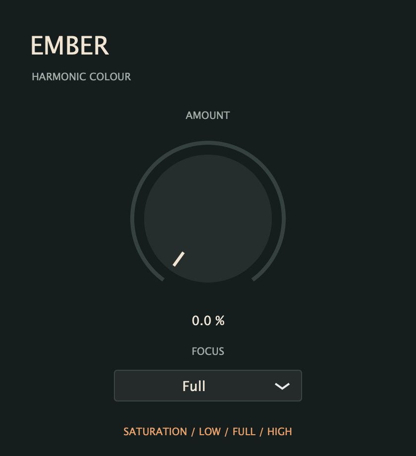

# Ember

Ember is a simple saturation effect that adds warmth, body, and bite to your sound. Use it to thicken drums and bass, bring texture to vocals, or push synths into heavier distortion.

Turn **Amount** for anything from subtle harmonic colour to a gritty edge. Choose **Focus** to preserve the low end, colour the full spectrum, or preserve the high end.

- VST3 for Windows x64 and macOS (Apple Silicon and Intel)
- Mono and stereo processing
- Automatable controls and saved settings
- Clean, compact interface

See [building and installing](docs/build.md) for setup instructions.
